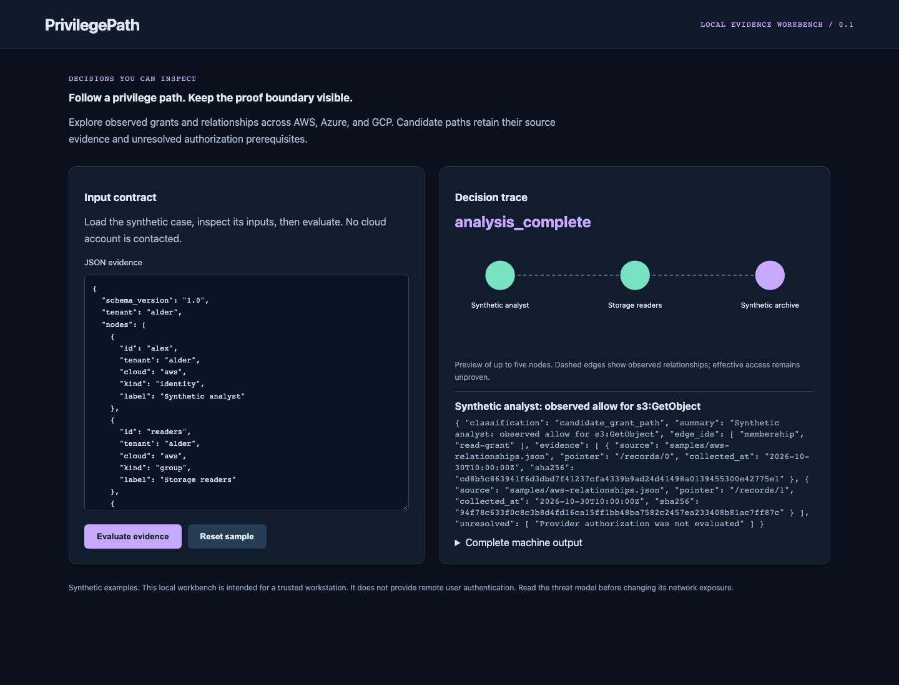

# PrivilegePath

[](https://github.com/jayekwere/privilegepath/actions/workflows/verify.yml)
[](LICENSE)

**Privilege paths with their authorization proof boundary intact.**

A TypeScript graph analyzer and Python offline import boundary for AWS, Azure and GCP relationship evidence. It traces membership, candidate role assumption and grants to a specific action/resource query. It reports observed denies and unresolved constraints without labeling candidate paths as effective access.



## Run locally

Requires Node 24.13+ or Node 26, and a trusted workstation. The initial setup downloads locked dependencies. Afterwards the core synthetic CLI and UI demos work offline. No cloud account or paid service is required.

```sh
git clone https://github.com/jayekwere/privilegepath.git
cd privilegepath
npm ci --ignore-scripts
npm run build
npm run demo
npm start
```

Open [http://127.0.0.1:8080](http://127.0.0.1:8080). For a container demo, run `docker compose up --build`. Compose publishes only to loopback, uses UID 10001, drops capabilities, denies privilege escalation and makes the root filesystem read-only. No input is persisted by the web evaluator. The default network posture is local-only. Do not expose a demo listener as a production service.

## What it enforces

- Nodes carry cloud, kind, tenant and identity. Edges carry relation, effect, actions, condition status, source pointer, collection time and source digest.
- Membership targets a group, candidate assumption targets a role, and grants terminate at resources. Dangling, duplicate, cross-tenant and cross-cloud relationships are rejected.
- Traversal avoids cycles, bounds depth and total work, and explicitly reports incomplete results. Missing paths are not proof of no access.
- Every candidate path retains all edge evidence. A can-assume edge retains an unresolved trust/session prerequisite. GCP actions match case-sensitively; AWS and Azure action matching is case-insensitive.
- Wildcard grants produce owner-review and simulation recommendations. Explicit grants receive no unsupported removal recommendation. Automatic permission removal is always unsafe in this model.

## Inputs, integrations and evidence

```sh
node dist/src/main.js analyze samples/azure.json
node dist/src/main.js analyze samples/gcp.json
python3 importer/normalize.py samples/aws-export.json artifacts/imported.json
node dist/src/main.js analyze artifacts/imported.json
```

The Python importer consumes an explicit, restricted offline export contract. AWS records retain statement Effect, Action and unresolved Condition; unsupported constructs such as NotAction reject. Azure and GCP require already-resolved action/permission lists and explicit resource mapping. This is a deliberate normalization boundary, not a claim that a provider-native export fully describes effective authorization. Demo graph evidence points to included synthetic relationship files; hashes cover canonical JSON records.

The `effective_permissions` object always reports `not_proven` with an empty proven set. A proven authorization result would need a separate provider-specific evaluator for an exact principal, action, resource, context and time. No such evaluator is claimed here.

Generated machine output is committed in [samples/output.json](samples/output.json). The [architecture](docs/architecture.md), [threat model](docs/threatmodel.md), [verification record](docs/verification.md), and [distinct scope](docs/portfolio-scope.md) explain the implementation and its boundaries. Strict runtime models are authoritative; published [schemas](schemas) document the contracts. External Terraform and SARIF metadata can carry provider extensions; security-relevant fields receive explicit validation.

## Verify

```sh
npm run verify
npx playwright install chromium
npm run test:browser
docker build -t privilegepath:local .
node scripts/container-smoke.mjs privilegepath:local
```

CI runs lint, strict TypeScript checks, unit/adversarial tests, measured coverage, builds, the local demo, browser interactions, dependency audit and a hardened container smoke check. Node source coverage is reported transparently; it is not a claim of complete path coverage. Every Action uses a verified full commit SHA, checkout credentials are disabled, and the verification workflow has only contents read permission. Browser installation and container builds need network during setup. Artifact retention is 14 days. Repository maintainers control policy and workflow changes.

## Limits and trust

AWS SCPs, resource policies, permission boundaries, sessions and trust semantics; Azure deny assignments and PIM activation; and GCP deny policies, principal access boundaries and condition evaluation are not evaluated. The collector resolves Azure role definitions and applicable inherited assignments, and reads accessible GCP ancestor allow policies. Role assumption edges are candidates, not proof that an STS exchange or token issuance would succeed.

Read-only cloud account collection is implemented and contract tested; AWS live acceptance is recorded with partial collection; Azure/GCP account acceptance remains unverified. Authorization simulation is unimplemented. Imported graph hashes and timestamps are caller assertions unless checked against an included source record. The separate collector binds native observations into private snapshots. The analyzer never authenticates a cloud snapshot, modifies IAM, or infers that unused permissions are safe to remove. The local UI has no authenticated multi-tenant storage. Tenant checks enforce consistency inside a submitted graph. Evidence files can contain sensitive identity metadata; keep real exports private.

 

See [SECURITY.md](SECURITY.md) and [CONTRIBUTING.md](CONTRIBUTING.md). MIT covers this repository's original code; dependencies retain their respective licenses.

## Native cloud collection

Read-only AWS, Azure and GCP collectors now preserve native policy evidence and emit analyzer-ready graphs. They are implemented and contract tested; AWS live acceptance is recorded with partial collection; Azure/GCP account acceptance remains unverified. Use [live collectors](docs/live-collectors.md) for private account setup, exact coverage, offline native fixtures and explicit scope limits. Collection completeness never proves effective access.

AWS account acceptance exercised 14 native API calls and preserved a private native snapshot. It returned partial coverage because a policy used resource variables requiring context, and analysis retained `effective_permissions: not_proven`. [The live receipt](docs/aws-live-verification.json) records source commits and snapshot digest. Azure/GCP account acceptance remains unverified.

The [security audit record](docs/security-audit.json) covers bounded wildcard analysis, malformed request containment, IAM resource-pattern fidelity and fixture provenance. The original offline sample output is unchanged.

---

**AI assistance:** AI tools helped with code or documentation.
