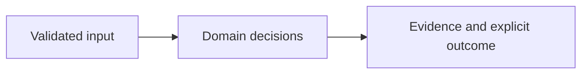

# Architecture

Offline provider evidence --> explicit normalization contract --> tenant/cloud graph validation --> bounded traversal --> candidate paths and observed denies --> owner-review recommendations

| Component/source | Responsibility |
| --- | --- |
| `importer/normalize.py:10` | Restricted offline provider export normalization |
| `src/graph.ts:35` | Strict graph and evidence contract |
| `src/graph.ts:62` | Tenant/cloud semantics, bounded traversal and explicit not-proven output |
| `src/io.ts:21` | Stateless local workbench |

## Effective resources

| Deployment or consumer | Configuration and location | Recipients or authority | Enforcing control |
| --- | --- | --- | --- |
| Graph evaluation | Caller-selected JSON or POST input; memory only | Local evaluator | Strict graph semantics; tenant consistency; no authenticated multi-tenant store |
| Offline importer | Caller-selected source/output paths; explicit resolved action/resource mapping | Trusted local operator | Unsupported constraints reject; output is a normalized observation graph |
| Web listener | HOST or 127.0.0.1; PORT or 8080 | Reachable clients, no accounts | Host/origin/size controls; loopback default; bounded graph work |

## Trust and decisions

An input author can supply graph labels, hashes and timestamps. Schema consistency does not authenticate their cloud origin. Membership, candidate assumption and grants have explicit endpoint semantics; cross-cloud or cross-tenant edges reject. Traversal returns simple bounded candidate paths, preserves observed deny evidence and unresolved conditions, and marks truncation. No path is converted to a proven provider permission. Explicit grants without usage evidence receive no removal recommendation.

Core domain decisions are separated from HTTP, CLI and external integration adapters. Runtime models reject unsupported contracts instead of interpreting arbitrary instructions. The UI renders supplied strings with textContent. Container startup uses UID 10001 and loopback publication through Compose. Setup downloads dependencies and optional tools once; core synthetic evaluation does not require a network.

## Unresolved integration scope

Provider collection is implemented in a separate Python CLI; account acceptance remains unverified. Authorization simulation is unimplemented. AWS SCPs/boundaries/resource policies/trust, Azure PIM/deny assignments and GCP denies/boundaries are not evaluated. The collector observes applicable Azure scope inheritance and accessible GCP ancestor grants without proving effective access. Missing paths never prove absence of access.

See the README for exact setup, sample outputs, decision semantics and limits. The threat model distinguishes hypotheses from source-established controls.

## Native collection extension

`collectors/__main__.py` adds an operator-only CLI using private local credentials. `collectors/core.py` constrains native transports and captures provenance; `collectors/providers.py` maps provider grants and hierarchy into graph semantics. [Live collectors](live-collectors.md) defines exact resource scopes and account verification limits. The HTTP evaluator cannot invoke these collectors or supply credentials.
